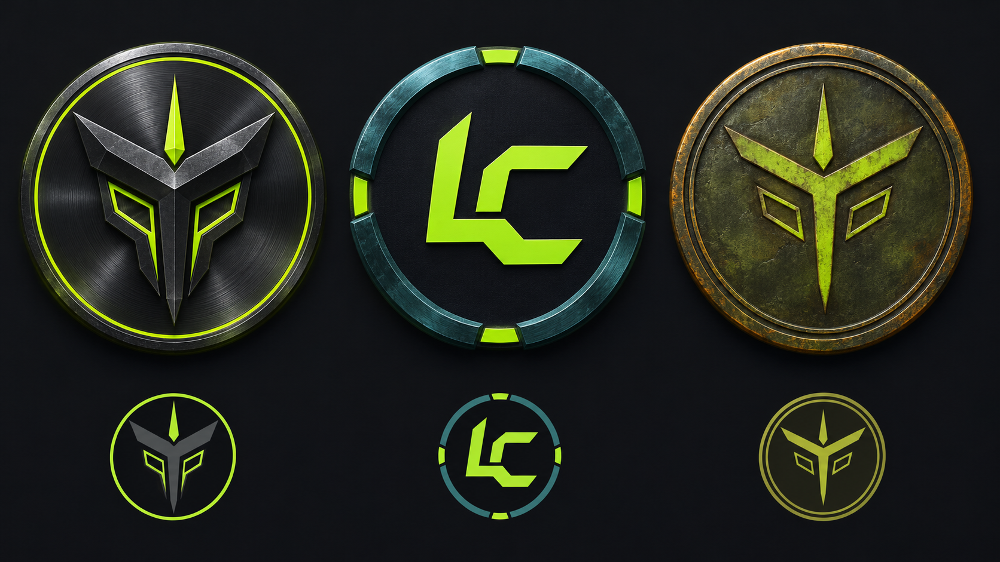

# Значок внутренней валюты MSLegion

Утверждён вариант № 1 — графитовая монета с угловатым шлемом MSLegion и тонким лаймовым кольцом. Это основной знак внутренней валюты для баланса профиля и других разделов экосистемы.

На листе референсов утверждён левый столбец. Верхнее изображение показывает объёмную монету, нижнее — упрощённую иконку для размещения рядом с суммой. В профиле Mini App используется фрагмент нижнего изображения рядом с металлически-золотой суммой. Карточки оформляются переменными всех [четырёх тем](mini-app-themes.md).

